 

   

  

  

<h3>GitHub Stats</h3>

 

  

<picture>
  <source media="(prefers-color-scheme: dark)" srcset="https://raw.githubusercontent.com/arswendoerz/arswendoerz/output/github-snake-dark.svg" />
  
</picture>

